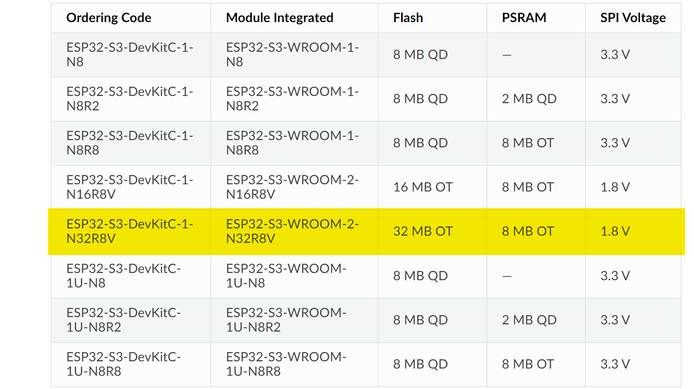

# ESP32-S3 Web Keyboard ⌨️

Turn an ESP32-S3 into a USB keyboard that you drive from a phone or a browser. Plug the board into any computer, open its web page over WiFi (or connect over BLE), and every key you press on screen is typed on the host machine as if it came from a real keyboard.




---

## Why this exists

The ESP32-S3 has native USB, so it can present itself to a computer as a plain HID keyboard. No driver, no agent, nothing to install on the host: the machine simply believes a keyboard is attached. This project puts a full on-screen keyboard in front of that, so a phone on the same WiFi network becomes a remote keyboard for a computer across the room, a headless machine, or a device with no keyboard attached at all.

## What it can do

- **Full on-screen keyboard** served straight from the board. Function row, number row, letters, punctuation, arrows, Home, End, Insert, Delete and Backspace.
- **Sticky modifier keys.** Ctrl, Alt, Shift, Win and Caps Lock latch on tap and light up, so a phone touchscreen can still send `Ctrl` + `Alt` + `Del`.
- **Free text field.** Type a whole sentence in the web page and send it as one burst instead of tapping key by key.
- **Two transports.** Reach the board over WiFi as a web server, or over BLE from a phone terminal app. Both feed the same command handler.
- **Run commands on the host.** `#cmd_...` opens the Windows command prompt and runs what follows; `#run_...` launches an application.
- **Settings that survive a reboot.** Configuration lives in SPIFFS through a small custom wrapper (`Cspiffs`), so values can be read and updated at runtime without reflashing.
- **ESP-NOW listener.** Accepts keystrokes forwarded from another ESP board, which is how it pairs with the sender side of the workshop projects.

## Hardware

| You need | Notes |
|---|---|
| ESP32-S3 development board | Native USB is the whole point, an ESP32 classic will not do |
| USB cable to the target computer | This is both power and the HID connection |
| Phone, tablet or laptop | Anything with a browser on the same WiFi network |

Pinout reference for the board is in `esp32-s2-devkitc-1-v1-pinout.png`, and `esp32-s3 setting.jpg` shows the Arduino IDE settings that make the USB stack come up correctly.

## Getting started

1. In the Arduino IDE, install the ESP32 board package and select your ESP32-S3 board. Set **USB Mode** to `USB-OTG` and enable **USB CDC On Boot**, matching `esp32-s3 setting.jpg`.
2. Libraries used: `BLEDevice`, `BLEServer`, `BLEUtils`, `WiFi`, `WebServer`, `USB`, `USBHIDKeyboard` and `esp_now`. All of them ship with the ESP32 board package, so there is nothing to download separately.
3. Create `arduino_secrets.h` next to the sketch with your network:

   ```cpp
   #define MY_SSID     "your-wifi-name"
   #define MY_PASSWORD "your-wifi-password"
   ```

4. Flash `working_code_with_lib/Working_code.ino`.
5. Open the serial monitor to read the assigned IP address, then browse to `http://<board-ip>/` and start typing.

## Command reference

Anything sent over BLE, over `/sendData`, or typed into the web page's text field goes through the same handler:

| Input | Effect |
|---|---|
| `test` | Prints a known word to the serial monitor, a quick liveness check |
| `#run_<name>` | Launches an application on the connected computer |
| `#cmd_<command>` | Opens the Windows command prompt and runs the command |
| anything else | Typed out verbatim on the connected computer |

HTTP endpoints: `GET /` serves the keyboard page, `GET /key` and `GET /sendData` accept a single key press or a string.

## Repository layout

| Path | What is in it |
|---|---|
| `working_code_with_lib/` | **Current firmware.** Web keyboard, BLE, HID and SPIFFS together |
| `Uploaded_code/` | The build currently flashed on the author's board, plus the `Cspiffs` helper |
| `wifi_provision.ino`, `wifi/` | WiFi provisioning experiments |
| `temp/html_work/` | Earlier iterations of the web keyboard page |
| `temp/BLE_HID/` | BLE and HID experiments before the two were merged |
| `temp/esp32s3 with rf/` | RF module work, pairing the board with a plain Arduino sender |
| `temp/LCD_Temperature/` | DHT sensor and I2C display side experiments |
| `usefull_cmds_and_fucntions.txt` | Scratch notes on commands and helper functions |

## Roadmap

Tracked as issues, contributions welcome on any of these:

- [ ] Special characters do not always type correctly ([#10](https://github.com/mhamidjamil/ESP32-S3_work/issues/10))
- [ ] Common keyboard shortcuts as one-tap buttons ([#4](https://github.com/mhamidjamil/ESP32-S3_work/issues/4))
- [ ] WiFi provisioning, so the network can be set without reflashing ([#9](https://github.com/mhamidjamil/ESP32-S3_work/issues/9))
- [ ] RF module support for use out of WiFi range ([#18](https://github.com/mhamidjamil/ESP32-S3_work/issues/18))

## Related projects

- [TTGO_TCall](https://github.com/mhamidjamil/TTGO_TCall) is the GSM side of the same setup, an SMS and call gateway on a TTGO T-Call board.
- [orangepi](https://github.com/mhamidjamil/orangepi) is the Orange Pi 5 Plus hub these boards report to.

## Contributing

Issues and pull requests are welcome, especially on anything in the roadmap. If you are picking up an open issue, leave a comment on it first so two people do not build the same thing.

> **Heads up:** the firmware moves faster than this page. Check the closed issues labelled `new feature` and `enhancement` for what landed most recently.
